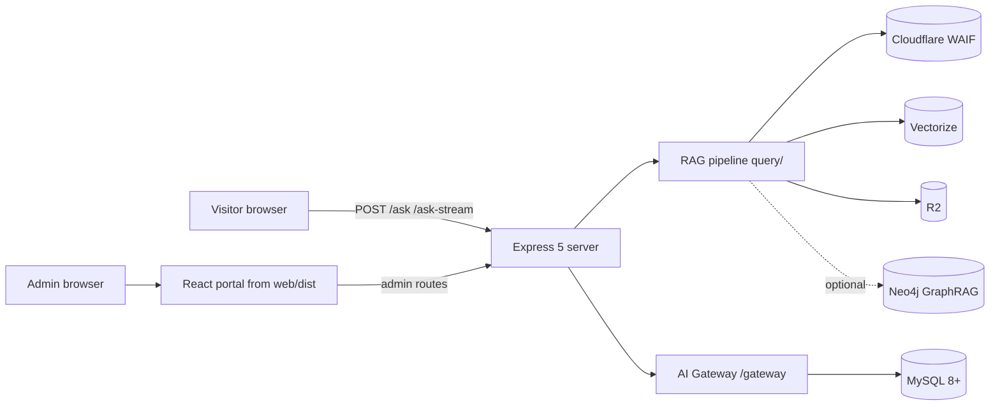

# PopularCert RAG API — Project Wiki

> **Purpose:** persistent knowledge layer for this repository. Source code is always the truth for current behavior; when a conflict is found, update this wiki.
> **Last synchronized:** 2026-08-27 against commit `d4eb11f` (verified by reading source; 663 tests passing).

## What this project is

A **multi-tenant Retrieval-Augmented Generation backend** (Express 5, Node ESM) that answers visitor questions for certification-services companies using Cloudflare Workers AI, Vectorize, and R2 — plus an optional **MySQL-backed AI Gateway platform** (provider catalog, encrypted credentials, knowledge bases, assistants) and a **React admin portal** served from the same Express process.

Start here: [[Project Overview]] · Navigation guide: [[Documentation Map]]

## High-level architecture

Architecture hub: [[System Architecture]] · request path: [[Application Flow]] · pipeline internals: [[Data Flow]] [[Ask Pipeline]]

## Navigation

| Area | Pages |
|---|---|
| **Overview** | [[Project Overview]] · [[Documentation Map]] |
| **Architecture** | [[System Architecture]] · [[Application Flow]] · [[Data Flow]] · [[Authentication Flow]] · [[Authorization Flow]] · [[Error Handling]] · [[Integration Architecture]] · [[Deployment Architecture]] · [[Security Model]] |
| **Backend** | [[Backend Overview]] · [[API Architecture]] · [[Routes Map]] · [[Middleware]] · [[Services Layer]] · [[Repositories]] · [[Background Jobs]] · [[Backend Dependencies]] |
| **Frontend** | [[Frontend Overview]] · [[Component Architecture]] · [[Pages and Routing]] · [[State Management]] · [[API Integration]] · [[UI Patterns]] · [[Frontend Dependencies]] |
| **Data** | [[Data Stores]] · [[MySQL Gateway Schema]] · [[Config Store Schema]] · [[Vector Data & Chunk Files]] · [[Data Lifecycle]] |
| **Infrastructure** | [[Environment Variables]] · [[Configuration]] · [[Storage]] · [[External Services]] · [[Deployment]] |
| **Development** | [[Local Setup]] · [[Development Workflow]] · [[Coding Standards]] · [[Testing]] · [[Debugging]] · [[Common Problems]] |
| **Decisions** | [[ADR Index]] · [[Change Log]] |

## Major features

- [[Multi-Tenancy & Company Config]] — isolated per-company models/prompts/resources
- [[Ask Pipeline]] & [[Answer Streaming]] — RAG QA, JSON or SSE
- [[GraphRAG]] — optional read-only Neo4j context injection
- [[Assistant Personas]] — selectable chatbot persona overriding pipeline defaults
- [[Ingestion]] — WordPress / URL / file sources → chunks → embeddings → vector store
- [[Knowledge Bases]] — tenant-scoped KB rows binding embedding model, storage, vector resource
- [[AI Gateway Platform]] — provider catalog, credentials, endpoints/pricing, live execution
- [[Scheduler]] — standalone jobs + cron schedules (ingest, testing)
- [[Logging & Audit]] — file logs, request logs, UI toasts, audit trail
- [[Ask API Keys]] — per-company gating of `/ask`

## Important decisions

See [[ADR Index]]. Highlights: [[ADR - Cloudflare Workers AI as the runtime AI provider]], [[ADR - Dual config store with CONFIG_STORE switch]], [[ADR - AES-256-GCM encryption at rest]], [[ADR - Provider-agnostic adapter layer]].

## Known risks

Curated list with evidence: [[Technical Debt]] · cross-cutting security posture: [[Security Model]]. Headliners: rate-limit key spoofing mitigated only behind your own proxy (`TRUST_PROXY`), answer cache lost on restart, single-process scheduler state.

## Documentation status

All pages verified against source on 2026-08-27 (commit `d4eb11f`). Where the original rationale for an implementation choice could not be confirmed from the codebase, ADRs say so explicitly instead of inventing reasons.