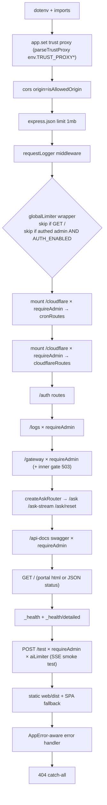

# Application Flow

The exact middleware chain of `app.js` (order matters).



\* Verified caveat: `env.js` does not define `TRUST_PROXY`, so `parseTrustProxy(env.TRUST_PROXY)` always sees `undefined` → defaults to `true`. Tracked as an issue in [[Technical Debt]].

## Boot sequence (app.js bottom)

1. `await initConfig()` — loads MySQL/SQLite companies into `runtimeConfig` (exits on failure).
2. If `CONFIG_STORE=mysql`: `await migrate()` auto-applies pending migrations (idempotent, checksummed).
3. `app.listen(PORT)`.

Static-portal readiness: `hasWeb = fs.existsSync(web/dist/index.html)` decides whether the portal is served at all.

## Per-endpoint flows that matter most

### Visitor ask (JSON)

```
Browser/Curl → globalLimiter → POST /ask
  → requireCompany (400 unless x-company-name matches known company)
  → requireAskApiKey (only when company has API_KEY set)
  → aiLimiter 20/min
  → askJsonHandler → pipeline.askQuestion(...,{signal})
  → res.json({ success:true, answer, sources, matches, graph, cached, possibleQuestions })
```

Client disconnect aborts the paid call via `AbortController` on `req.on("close")`.

### Admin portal session

```
Login page → POST /auth/login (10/min limiter) → {token}
→ every admin API call adds Authorization: Bearer (api.js)
→ 401 anywhere triggers 'admin-unauthorized' event → forced logout (web/src/auth.jsx)
```

### Ingestion start (two equivalent doors)

1. Portal Scheduler page → `POST /cloudflare/job/start {jobId:'ingest', companyName, kbKey?...}`
2. Gateway KB page → `POST /gateway/kbs/:key/ingest` → internally starts standalone job (`mysql/routes/kbs.js`, `cron/index.startJob`)

Both end up running `jobs.js` handler `ingest.main({signal, companyName, kbKey,...})`.

## Error flow

Any thrown `AppError` subclass bubbles to the final error handler which emits `{success:false,error,code?,errors?}` with its status; everything else logs and returns generic 500. Detail: [[Error Handling]].