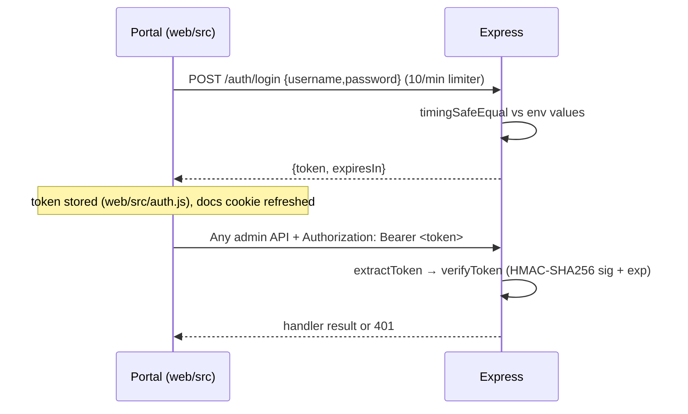

# Authentication Flow

Two independent mechanisms exist (**both verified**):

## 1. Admin sessions (portal + admin APIs)

Opt-in: enabled only when `ADMIN_USERNAME` **and** `ADMIN_PASSWORD` are set (`auth.js AUTH_ENABLED`). When disabled every admin route stays open and `/auth/me` reports `authenticated:true`.

Token format: `base64url({u,exp}).base64url(HMAC_SHA256(payload, SECRET))` — **not** JWT, no registry, stateless verification only.

| Detail | Source evidence |
|---|---|
| Secret = `ADMIN_SECRET`, else ephemeral random per boot (sessions die on restart; warning logged) | `auth.js` lines 10–20 |
| TTL = `ADMIN_TOKEN_TTL_HOURS` hours (default 12) | `auth.js` |
| Token extraction order: `x-auth-token` header → `Authorization: Bearer` → `pc_admin_token` cookie | `extractToken()` |
| Swagger only: portal mirrors token into path-scoped cookie `/api-docs` (SameSite=Lax, not HttpOnly) so new-tab docs work; UI also re-injects via request interceptor reading localStorage or `?token=` | `app.js` swagger setup, `web/src/auth.js refreshDocsCookie` |
| Login returns 503 when auth is configured-off rather than letting anyone "log in" | `routes/auth.js` |

Portal trust model: fail-closed on boot (`/auth/me` must explicitly report authenticated). Any 401 on protected paths triggers global logout event (`web/src/api.js onUnauthorized`).

## 2. Per-company ask API keys (`x-api-key`)

Applies exclusively to `/ask`, `/ask-stream`, `/ask/reset` when that company stored an `API_KEY`. Canonical page: [[Ask API Keys]].

Generation/rotation: `POST /cloudflare/companies/:name/apikey` → `generateApiKey()` = `pk_` + 24 random bytes base64url, shown exactly once; revocation deletes it (back-compat: companies without key stay open).

## What is NOT implemented (explicit)

- No user accounts/roles beyond single admin pair.
- No refresh tokens/session persistence across restarts when secret unset.
- No OAuth/SAML/OIDC anywhere (**absence confirmed**).

See [[Security Model]] for the threat-relevant summary and [[ADR - Opt-in admin auth via HMAC session tokens]] for decision context.