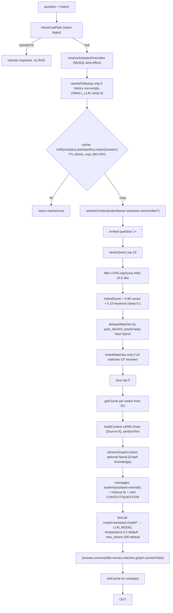

# Data Flow — RAG answer path

Canonical orchestration lives in **`query/answer.js → runPipeline()`** (both JSON and SSE call it; step functions are injectable for tests).

## Constants (verified in source)

| Constant | Value | File |
|---|---|---|
| `VECTOR_LIMIT` / `FINAL_TOP_K` | 10 / 5 | `query/retrieval.js` |
| `SCORE_THRESHOLD` / `ABSOLUTE_MIN_SCORE` | 0.75×top / 0.5 | `query/retrieval.js` |
| `MIN_RERANK_MATCHES` | 4 (rerank skipped below it) | `query/reranker.js` |
| `MAX_CONTEXT_CHARS` | 4000 | `query/context.js` |
| `MAX_HISTORY` | 6 messages | `query/llm.js` |
| Cache TTL / size | 60 min / 200 entries FIFO | `query/cache.js` |
| Default temperature / tokens | 0.3 / 500 | `query/answer.js` |
| `GRAPH_MAX_ROWS` / chars / timeout | 20 / 2500 / 15 s | `query/graph.js` |

## Stage-by-stage notes

- **Fast path precedes assistant resolution** (`runPipeline` calls `fastPathFn(trimmed, companyName)` first), so canned responses don't reflect an assistant's name even when one is selected — a *confirmed* observable nuance of ordering, not a bug claim.
- **Empty retrieval** short-circuits to the canned `noContext` response (`buildResponses().noContext`) with contact link.
- **Sanitization** (`query/context.js sanitizeText`) strips prompt-injection phrases like "ignore previous instructions", "system prompt", "developer instructions" from both titles and chunk bodies.
- **Sources** returned to clients are lightweight `{title, score}` pairs; full matches ride along (metadata included).
- **possibleQuestions** are generated *after* the answer via SMALL_LLM (temp 0.7); streaming sends them as their own frame before `[DONE]`; JSON adds them to the payload; aborted clients skip generation.

## Ingestion data flow

Documented canonically at [[Ingestion]] with its own diagram; chunk/vector record shapes live in [[Vector Data & Chunk Files]], lifecycle in [[Data Lifecycle]].