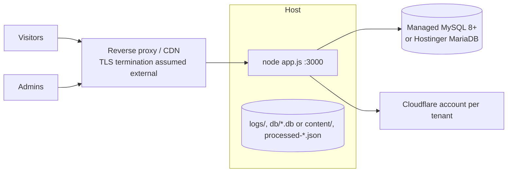

# Deployment Architecture

## What actually exists (verified)

- **Single Node process** (`node app.js`) that serves API + static portal + Swagger. No clustering/PM2 config, no containers (no Dockerfile/compose in repo — absence confirmed).
- **Migrations auto-applied at boot** when `CONFIG_STORE=mysql` (`await migrate()` inside app.js) — idempotent and checksummed; also runnable manually via `node mysql/migrate.js [--dry-run]`.
- **Config hot-swap**: models/resources can change via admin APIs without restarts because the pipeline reads the runtime singleton each call; but code changes require a process restart.
- Ephemeral-secret caveat: without `ADMIN_SECRET`, every deploy/restart invalidates portal sessions.

## Runtime topology facts

| Concern | Reality | Consequence |
|---|---|---|
| Scale unit | one OS process; jobs/cron/answer-cache are in-memory | vertical only; multi-instance would duplicate scheduler state & cache coherence issues ([[Background Jobs]], [[Technical Debt]]) |
| State dirs | `db/` SQLite configs+presets, `logs/` files, `content/` markdown/uploads cache, `processed-*.json` registries — all local-disk relative to cwd | persistent disk needed for those paths if run outside repo checkout |
| Portal delivery | built `web/dist` served with hashed assets + no-cache HTML | CI must build web before deploy ([[Deployment]]) |
| Port/env | `PORT` (3000 default), `NODE_ENV` gates console verbosity only | N/A |

## Deploy checklist derived from source

1. Provision `.env` per [[Environment Variables]] (MySQL, admin creds, APP_ENCRYPTION_KEY, optional ADMIN_SECRET/TRUST_PROXY intent).
2. `npm install`; approve install scripts policy already encoded in package.json allowScripts.
3. Build portal: `cd web && npm install && npm run build`.
4. Apply migrations (auto on boot; verify with `--dry-run`).
5. Start behind a TLS proxy; set explicit hop count so rate limiting keys correctly *(blocked by env gap — see [[Technical Debt]])*.
6. Smoke-test: `GET /_health`, login, POST `/ask` for a tenant.

## Observability at runtime

`/_health` aggregates MySQL ping + first-company-with-token Vectorize/R2 probes (5 s timeout each; status healthy/degraded/unhealthy → HTTP 503 when unhealthy). `/_health/detailed` adds latency breakdowns (`utils/health-check.js`). Request traces via X-Request-Id emitted by request logger ([[Logging & Audit]]).