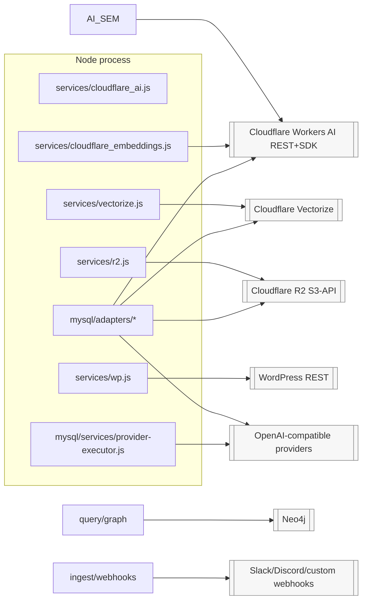

# Integration Architecture

Every outward-facing third party, its adapter seam, failure posture, and current scope.

## Integration map

## Per-integration contracts

| Integration | Adapter / seam | Transport | Retries/timeouts | Used by |
|---|---|---|---|---|
| Workers AI (chat/embed/rerank) | `cloudflare_ai.js runCloudflareAI` (SDK) & `fetchCloudflareAI` (raw fetch, streaming) | Bearer per-company token | SDK defaults; stream transport owns 30 s abort combined with client signal | [[Ask Pipeline]], reranker, follow-ups |
| Embeddings batching | `cloudflare_embeddings.js` (batch 4, concurrency 2, prealloc order) | raw REST | 5 retries exponential+jitter; honors `Retry-After` on 429 | retrieval + ingestion |
| Vectorize CRUD/query/upsert | `vectorize.js` (+ `mysql/adapters/vector/cloudflare-vectorize.js` for KB path) | CF SDK | fail-fast batches; countVectors best-effort null | indexing & QA |
| R2 objects | `r2.js` S3 client endpoint `https://<account>.r2.cloudflarestorage.com` | AWS SDK v3 | HeadObject existence skip; clearBucket paginates 1000 | chunk store |
| WordPress source | `wp.js` fetchWP/fetchWpByIds/listAllSourcePages (`per_page=100`, `X-WP-TotalPages`, 300 ms delay) | node-fetch | `retry()` wrapper | [[Ingestion]] wordpress scope |
| URL/sitemap crawl source | `ingest/sources/url.js` cheerio extraction (article→main→body), slug/title heuristics | node-fetch UA `RAG-Ingestion-Bot/1.0` | per-fetch timeout 15 s, retry 3, concurrency 3, ≤1000 urls sitemap-aware incl index child sitemaps | KB source_type=url |
| File uploads (.txt/.md/.html/.pdf/.docx) | `ingest/sources/file.js` (pdf-parse lazy CJS import, mammoth docx, simple md→html) | fs staging copy to `content/<company>/uploads/` | none (read once) | KB source_type=file |
| Neo4j GraphRAG | `query/graph.js withSession` lazy-imported driver | bolt uri from company config | 15 s cypher timeout; every failure degrades to no-context | [[GraphRAG]] |
| Arbitrary LLM providers (catalog-driven) | `provider-executor.js` wire-format translators → OpenAI-style normalized output; registry supplies base URLs/auth headers | HTTPS | probe-based verify; executor errors carry status | `/gateway/.../execute/*`, live "Test" buttons |
| Slack/Discord/generic notification | `ingest/webhooks.js` platform auto-detect by URL patterns | fetch POST JSON | 10 s abort, fire-and-forget | post-ingest events |
| Swagger tooling | `docs/openapi.js` served by swagger-ui-express w/ interceptor | same origin | n/a | docs page |

## Cross-cutting rules for new integrations

1. Never call external services from routers directly — add a service module or adapter factory entry ([[ADR - Provider-agnostic adapter layer]]).
2. Credentials must flow from `resolveCreds(company)` or decrypted gateway rows — nothing reads provider keys from env (env holds only infra/admin knobs, `env.js`).
3. Respect company scoping: pass `companyName` down; per-company client caching keyed by credential fingerprint (`client.js`).
4. Add failure posture deliberately: prefer degrading best-effort for *optional enrichment*, throwing typed errors for required correctness ([[Error Handling]]).