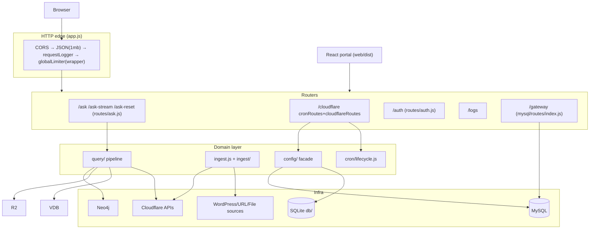

# System Architecture

## Layers (all in one Node process)

- **Config facade** (`config/index.js`) — sanctioned import path for companies/config; synchronous reads over `runtimeConfig`, persist-first writes. See [[Configuration]], [[Multi-Tenancy & Company Config]].
- **Query pipeline** (`query/`) — pure-ish step functions; both JSON and SSE paths share `runPipeline()`. See [[Data Flow]].
- **Ingestion** (`ingest.js` composition root → `ingest/pipeline.js` pure loop with injected adapters). See [[Ingestion]].
- **Gateway platform** (`mysql/`) — repositories → services → routers at `/gateway`; the only stateful multi-provider catalog. See [[AI Gateway Platform]].
- **Shared contracts** (`shared/`) — typed errors ([[Error Handling]]), enums/validation regexes shared by server+portal.

## System boundaries

| Boundary | Interface | Notes |
|---|---|---|
| Visitor sites ↔ API | `POST /ask`, `/ask-stream` (+ `x-company-name`, optional per-company key) | Only AI endpoints gated by company API keys |
| Portal ↔ API | `/auth`, `/cloudflare/*`, `/gateway/*`, `/logs`, static assets from `web/dist` | Session token via header or path-scoped cookie for Swagger |
| Pipeline ↔ Cloudflare | `services/cloudflare_ai.js` is the single AI seam; SDK clients cached per company+credential fingerprint (`client.js`) | |
| Gateway ↔ RAG config | one-way mirror via `mysql/services/rag-sync.js` | see [[ADR - Gateway-to-RAG credential mirroring]] |
| Ingestion ↔ storage | adapter contract `{store,index,registry}`; KB-driven adapters resolved by `ingest/resolve.js` | [[ADR - Provider-agnostic adapter layer]] |

## Communication patterns observed

- Synchronous request/response everywhere except: SSE streaming asks, fire-and-forget webhooks after ingestion, background job execution in-process.
- No queues/message broker exists (**confirmed absence**) — "background" means in-process `standaloneJobs` Map; scaling beyond one process would require redesign. See [[Background Jobs]], [[Technical Debt]].

## Key invariants worth preserving

1. Company resolution and credential decryption happen only through `config/` public exports (`resolveCreds`, `getCompanyConfig`). Plaintext exists only in memory.
2. All I/O outside adapters goes through `client.js` per-company clients so a rotated credential rebuilds stale clients (SHA-256 fingerprint).
3. Pipeline step order documented in `query/retrieval.js` and enforced by tests — reorder knowingly.
4. `schema/v5.sql` is frozen; platform evolution only via new migration files.