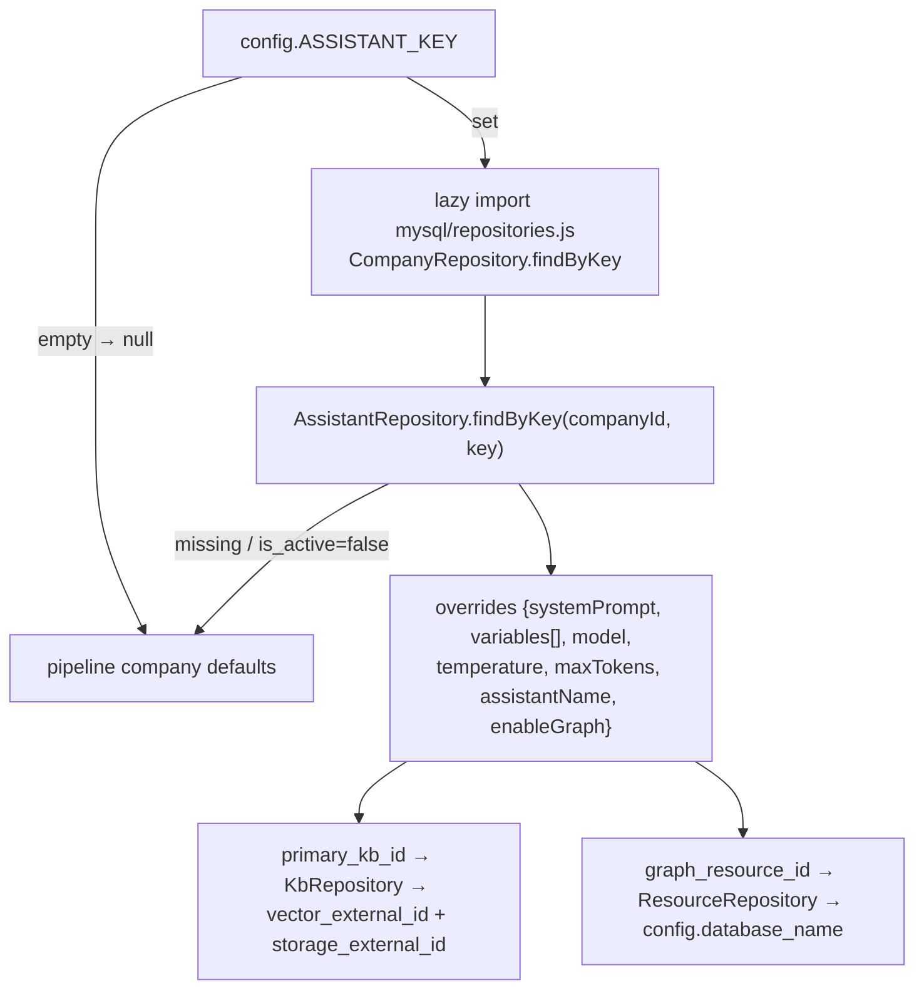

# Assistant Personas

## Purpose

An **Assistant** is a named chatbot persona bound to concrete resources. Selecting one on a company swaps the pipeline's defaults wholesale — without code or redeploy: greeting name, system prompt, model, temperature/token limits, retrieval index, and graph database.

## Binding resolution (`query/assistant.js`)

Best-effort everywhere: missing MySQL, unknown assistant, or any thrown error ⇒ `null` overrides, company defaults apply. Never breaks an ask.

## Override semantics in runPipeline (exact behavior)

| Concern | With assistant | Without |
|---|---|---|
| Static reply identity (identity/contact/discovery copy) | `assistantName` replaces the consultant default in canned responses | consultant default |
| Fast-path timing | assistant resolved **first**; its name feeds the identity fast-path (TD-9 resolved 2026-09-17) | — |
| Cache key | includes assistantKey segment | empty segment |
| Rewriter/cache miss? | unchanged SMALL_LLM | unchanged |
| System prompt | assistant.system_prompt, `{{VAR}}` resolved from assistant.variables ⊕ company PROMPT_VARIABLES (assistant wins) | company SYSTEM_PROMPT + its PROMPT_VARIABLES |
| Guardrail prompt | assistant.guardrail_prompt **replaces** the built-in Topic Scope system block (so it must re-include the injection defense) | company GUARDRAIL_PROMPT else built-in |
| Blocked topics | assistant.blocked_topics (newline-separated substring regexes) refused pre-retrieval; adds to company BLOCKED_TOPICS | company BLOCKED_TOPICS + built-ins |
| Blocked patterns | assistant.blocked_patterns **fully replaces** the built-in fast-path veto set (literal lines or `/regex/` — see `shared/blocked-patterns.js`; recipes/code personas ship their own set) | company `BLOCKED_PATTERNS` config, else built-ins |
| History window | same MAX_HISTORY=6 | same |
| Generation model | assistant.model — executed through the gateway provider executor with the assistant's credential when non-`@cf`·non-`@cloudflare` (`execution` binding); Workers AI path for `@cf`/`@cloudflare` keys; company LLM_MODEL only as fallback when no credential is bound | LLM_MODEL |
| temperature/max_tokens | override else 0.3/500 | 0.3/500 |
| Retrieval index | primary KB's `vector_external_id` passed as indexName | company VECTOR_INDEX |
| Chunk bucket (ask-time) | primary KB's `storage_external_id` passed as storageBucket → `getChunk` reads from that bucket; part of the cache-key fingerprint | company R2_BUCKET_NAME (getChunk default) |
| Graph | enabled flag + database override | implicit if creds exist |

⚠️ Because query-time retrieval still uses Workers-AI-only embeddings/seam, a KB backed by non-CF providers ingests fine but isn't queryable by this path (architecture observation, [[Knowledge Bases]]).

## Management surfaces

- Portal **Assistants page** (CRUD against `/gateway/assistants*`): binds credential, catalog model, primary KB, graph resource, `enable_graph_context`, assistant_variables ({{KEY}} injections — override the company tier), system prompt, guardrail prompt + blocked topics + blocked patterns (Prompt tab, guardrails section), temperature/max_tokens, activation toggle. The Prompt tab also shows the company's `PROMPT_VARIABLES` as copyable chips, striking through any the assistant overrides. Company-level blocked patterns live on Config → Security (Blocked Patterns card).
- Company attach: Config page dropdown writes `ASSISTANT_KEY` (validated `^[a-z0-9-]{3,63}$`).
- Config → **Models** tab shows an "Assistant's Knowledge Base (in use)" card when an assistant with a primary KB is selected — a read-only mirror of the primary KB's effective Vector Index, Storage (R2) Bucket, Graph Database and Embedding Model, sourced from `listKbs`. It makes clear those values (not the company-level selectors below it) are what the ask path uses; edit them on the Knowledge Bases page. The company-level selectors remain the fallback used only when no assistant is selected.
- Switching assistants instantly alters answers because resolution happens per ask call (cache keyed accordingly).

Tests: `mysql/__tests__/assistant-service.test.js`, `gateway-assistants.test.js`, `query/__tests__/assistant-modules.test.js`. Related: [[Multi-Tenancy & Company Config]].