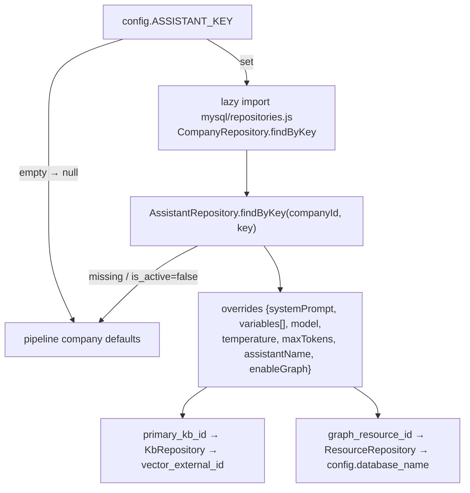

# Assistant Personas

## Purpose

An **Assistant** is a named chatbot persona bound to concrete resources. Selecting one on a company swaps the pipeline's defaults wholesale — without code or redeploy: greeting name, system prompt, model, temperature/token limits, retrieval index, and graph database.

## Binding resolution (`query/assistant.js`)

Best-effort everywhere: missing MySQL, unknown assistant, or any thrown error ⇒ `null` overrides, company defaults apply. Never breaks an ask.

## Override semantics in runPipeline (exact behavior)

| Concern | With assistant | Without |
|---|---|---|
| Static reply identity (identity/contact/discovery copy) | `assistantName` replaces CONSULTANT_NAME in canned responses | consultant default |
| Fast-path timing | canned path taken **before** assistant resolution (TD-9 nuance) | — |
| Cache key | includes assistantKey segment | empty segment |
| Rewriter/cache miss? | unchanged SMALL_LLM | unchanged |
| System prompt | assistant.system_prompt (+variable array merged) | company SYSTEM_PROMPT |
| History window | same MAX_HISTORY=6 | same |
| Generation model | assistant.model **only if `@cf/`·`@cloudflare/` prefixed** (`isRunnableModel`) else company LLM_MODEL | LLM_MODEL |
| temperature/max_tokens | override else 0.3/500 | 0.3/500 |
| Retrieval index | primary KB's `vector_external_id` passed as indexName | company VECTOR_INDEX |
| Graph | enabled flag + database override | implicit if creds exist |

⚠️ Because query-time retrieval still uses Workers-AI-only embeddings/seam, a KB backed by non-CF providers ingests fine but isn't queryable by this path (architecture observation, [[Knowledge Bases]]).

## Management surfaces

- Portal **Assistants page** (CRUD against `/gateway/assistants*`): binds credential, catalog model, primary KB, graph resource, `enable_graph_context`, assistant_variables ({{KEY}} injections), temperature/max_tokens, activation toggle.
- Company attach: Config page dropdown writes `ASSISTANT_KEY` (validated `^[a-z0-9-]{3,63}$`).
- Switching assistants instantly alters answers because resolution happens per ask call (cache keyed accordingly).

Tests: `mysql/__tests__/assistant-service.test.js`, `gateway-assistants.test.js`, `query/__tests__/assistant-modules.test.js`. Related: [[Multi-Tenancy & Company Config]].