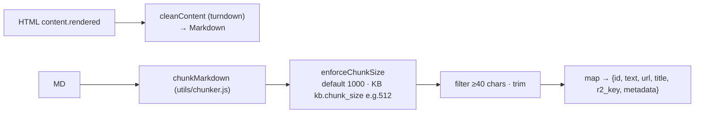

# Document Processing & Chunking

Path a raw item follows between fetch and vector storage (all inside ingest path; verified module by module).

## Stage pipeline

## Chunker behavior details (heading-aware)

- Splits on `#/##/###/####`; `#` captures doc title; section names normalized into buckets overview/benefits/process/requirements/cost/faq via keyword matching.
- **FAQ sections further split** into Q/A entries (question = line ending "?").
- Domain metadata extraction (`extractMetadata`): service = ISO pattern match else title prefix; country = trailing "in X".
- Cleaning strips images/links/heading marks/marketing phrases ("get free consultation now", "download brochure"), collapses blank runs.
- Content dedupe within call by first-200-chars key; drops <30 chars.
- Fallback for long documents without headings: paragraphs >80 chars become standalone chunks ("content" section).

## Size enforcement

Double-newline accumulate split keeping ≤max; empty-buffer guards; result re-trimmed. Two defaults exist deliberately: legacy/company path max **1000**, KB path passes its configured `chunk_size` (commonly 512).

## Special-format ingestion

URL source pre-normalizes pages (nav/footer/script/style removal, article→main→body precedence, title heuristics og:title→title→h1→path). FILE source converts pdf/docx/md/html/txt into synthetic WP-shaped HTML first so downstream is uniform ([[Ingestion]] adapter table).

## Downstream contract

Each chunk becomes: R2 JSON object keyed `${prefix}/${type}/${pageSlug}/chunk-${i}.json` containing text/title/url/metadata as consumed by retrieval's getChunk+buildContext ([[Vector Data & Chunk Files]]); vector id = sha256(prefix/slug)[0..48]-i guarantees stable re-ingestion identity incl. per-KB uniqueness (F14 note in source).

Embedding happens inside vector upsert adapters batch-wise, preserving array order (nulls on failed batches) rather than at this stage.