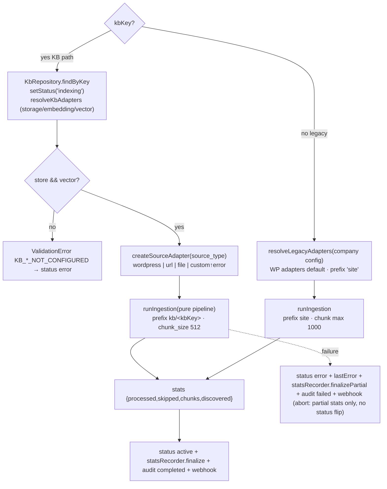

# Ingestion

## Purpose

Fetch source documents → convert to Markdown → chunk → embed → store chunk JSON + vectors → remember progress. Runs as an abortable background job (manual or scheduled), scoped per company and optionally per KB.

## Composition root — `ingest.js main({signal, companyName, kbKey, maxPages, scope})`

## Pure pipeline (`ingest/pipeline.js`) stages

1. `store.ensureBucket()` / `index.ensureIndex()` (abort-checked).
2. Per content type (`scope.contentTypes` default post+page):
   - **all / limit** modes paginate `fetchPost`/`fetchPage`; **selected** mode batches IDs via `fetchWpByIds`.
   - `registry.isStale(key, modifiedDate)` skips unchanged docs.
   - `transformItem`: clean → chunk ([[Document Processing & Chunking]]) → build vector chunks with deterministic ids & r2 keys ([[Vector Data & Chunk Files]]).
   - Upload chunk JSONs concurrently (p-limit 5) then `index.upsert(vectorChunks)` owns embedding+batching.
   - `registry.record(key, modified)` after each doc.
3. Stats accumulate; `setProgress` phases emitted (fetching→done).

## Source adapters

| Type | Module | Notes |
|---|---|---|
| file (**default** since 2026-09-28) | ingest/sources/file.js | txt/md/html/pdf/docx from upload staging, copy into content/<company>/uploads |
| url / website | ingest/sources/url.js + `ingest/sources/sitemap/` | **A website URL is all the user supplies — the sitemap is discovered automatically**: `{origin}/robots.txt` → `Sitemap:` directives → standard fallbacks (`/sitemap.xml`, `/sitemap_index.xml`, `/wp-sitemap.xml`) → recursive `<sitemapindex>` expansion → deduped in-scope `<urlset>` URLs. CMS-independent: never calls the WordPress REST API, so it is immune to plugin/WAF mangling of `/wp-json` |
| wordpress — **withdrawn** | services/wp.js via wpAdapters | X-WP-TotalPages pagination, 300 ms pacing; **failure contract (2026-09-28): source failures THROW** `ExternalServiceError` (HTML-instead-of-JSON body detection, invalid JSON, HTTP errors) — listing exhaustion still returns `null`. Hidden from the wizard + rejected by the create/update API, but existing rows still resolve and ingest unchanged |
| custom — **withdrawn** | ingest/sources/rest.js | generic JSON feed via `source_config.rest`; no mapping editor yet |

**Offered vs withdrawn** — `shared/catalog-enums.js` owns `KB_DISABLED_SOURCE_TYPES` (`wordpress`, `custom`) and derives `KB_ENABLED_SOURCE_TYPES` (`file`, `url`) + `KB_DEFAULT_SOURCE_TYPE` from it. The portal renders only the offered cards and the API (`validateKbInput`, `PUT /kbs/:key/sources`) rejects a withdrawn type **unless it is the row's unchanged stored value** — so legacy KBs stay editable and keep ingesting, and nothing new can be pointed at a broken source. Re-enable by emptying that one list. **Use `url` + `/wp-sitemap.xml` for WordPress sites.**

All return WP-shape items so the pipeline stays provider-agnostic.

### Sitemap discovery (`ingest/sources/sitemap/`)

Discovery is a standalone, testable layer that knows **how to find URLs and nothing else** — no chunking, embeddings, R2 or Vectorize knowledge (§38). Each file is independently testable; HTTP goes through one `fetchText` primitive so timeout/retry/redirect/size rules are applied exactly once.

| File | Role |
|---|---|
| `normalize.js` | `normalizeWebsiteUrl` (http/https only, fragment dropped, path kept, trailing slash normalized), `resolveUrl` (standard `URL` API, never string concat), `buildScope`/`isInScope` (entered host + its `www.` sibling by default; `allowSubdomains`/`allowExternal` opt out), `dedupeKey` (fragment/casing/trailing-slash unified, **path + query preserved**), `SitemapError` (carries `code` + `status`) |
| `robots.js` | Fetches `{origin}/robots.txt` **always from the origin, never the user's path**. `parseRobotsTxt` is total: `sitemap:` matched case-insensitively, multiple directives, relative references resolved, malformed/unsupported-protocol lines logged and skipped. Never throws — 404/403/5xx/timeout all degrade to "no directives" so fallbacks still run |
| `parser.js` | `parseSitemapXml` via **cheerio XML mode** (a real parser, not regex — the old `<loc>` regex in `url.js` corrupted entities). Walks the tree by **local name** so both `xmlns=` and prefixed `<sm:urlset>` work. Returns `{ type: urlset\|sitemapindex\|unknown, … }` — a 200 alone never marks a response as a sitemap |
| `crawler.js` | Breadth-first expansion with a `visited` Set (**A→B→A terminates**), `maxDepth`, and `maxSitemaps`/`maxUrls` caps that are **reported** via `truncated`, never silently applied. One failing sitemap is recorded in `errors[]` and the walk continues |
| `discover.js` | Orchestrates robots → fallbacks → crawl. Throws `NO_SITEMAP_FOUND` (404) with a **user-facing** message, never a parser/transport error |
| `http.js` | `fetchText` — timeout, retry (4xx never retried), redirect cap, hard byte cap, honest `User-Agent` (**never Googlebot**). `DEFAULT_DISCOVERY_LIMITS` is the single place limits live |
| `log.js` | `[WebsiteDiscovery]`-prefixed console + file logs; URLs and counts only, never credentials |

`discoverSitemaps(websiteUrl, opts)` returns `{ websiteUrl, robotsUrl, robotsFound, discoveredSitemaps, urls:[{url,lastModified}], stats, truncated, errors }` — a plain result object, so the route layer and tests consume it without any I/O of its own. `fetchImpl` is the test seam (same pattern as the importer's `opts.getPool`).

**Verified live** (2026-09-28): `discoverSitemaps("https://maxicert.com")` → robots.txt → `sitemap_index.xml` → 7 children → **830 URLs in 4.7s**, zero errors, not truncated — the same site whose WordPress REST API returns CSS-prefixed HTML.

Downstream is pure reuse (§22, §38): pages are fetched, `parseHtmlToItem` extracts title/content, and `ingest/pipeline.js` `transformItem` does the existing cleaner → Markdown → chunker → R2 → embedding → Vectorize work. Chunk ids stay **deterministic** (`sha256(r2Prefix/pageSlug)-index`, no `Date.now()`), so a re-ingest updates rather than duplicating. Web provenance rides along in chunk metadata as `sourceType`/`websiteUrl`/`lastModified` (stored, not filter-indexed, so existing Vectorize indexes need no change).

## Adapter resolution (`ingest/resolve.js`)

KB rows bind infrastructure ids: storage_resource_id → connection credentials → `{cloudflare-r2,s3}` store factory; embedding_model_id → provider/model resolution → first active credential of that provider (decrypted) → embedding factory (cloudflare-ai/openai/openrouter); vector_resource_id → vector factory receiving the embedding adapter. Cloudflare creds fall back to company config on the legacy path.

## Failure, abort & notifications

AbortError at any boundary unwinds cleanly (job entry removed, no status flip). Real failures flip KB status/error, write audits, fire webhooks (HMAC-signed) — [[Logging & Audit]], [[Background Jobs]].

## Last-run stats (`ingest/stats-recorder.js`)

`last_ingestion_*` on the KB row (migration 014) powers the portal KB cards' **Chunks** / **Last run** cells (`GET /kbs/:key/status` → `lastIngestion`). Since 2026-10-12 these are persisted by `createIngestionStatsRecorder` **during** the run, not only on completion:

- `onProgress(progress)` — throttled checkpoint (~10 s, `DEFAULT_CHECKPOINT_INTERVAL_MS`) off the pipeline's `setProgress` stream; survives a hard process kill (server restart mid-run used to leave the stats NULL forever — the 2026-10-12 propularcert-prod-kb incident: docs + vectors existed but the card showed "Chunks — / Last run never"). Snapshots with 0 processed/0 chunks (discovery phase) never stamp, so an early abort can't overwrite the previous run's numbers with zeros.
- `finalize(stats)` — the exact final write on clean completion (replaces the old inline `setIngestionStats` call in ingest.js).
- `finalizePartial()` — flushes the captured snapshot on abort (stop/pause) and before the D12 error recording (ordering matters: the stats write nulls `last_error`).

All writes are best-effort (a stats failure never masks the ingest outcome), and legacy non-KB runs (`kbId` null) never write. Tests: `ingest/__tests__/stats-recorder.test.js`.

**Source failure contract (2026-09-28, maxicert-test-kb incident):** `fetchWP` in services/wp.js used to swallow every error into `null`, which `processContent` read as "no more items" — a WP REST API that returned HTTP 200 + `Content-Type: application/json` with an **Elementor HTML body** (origin/WAF hijack) produced a "successful" 0-document run that still stamped `lastSyncAt` and kept status `active`. Source fetchers now throw `ExternalServiceError` (502; body-shape check — headers are not trusted — plus parse-error and HTTP wrapping; unknown-company `fetchWpByIds` → `ValidationError`), so D12 records status `error` + a last_error that names the site and the fix, and `lastSyncAt` is only stamped by real completions. The KB detail page shows the banner.

Registry rules incl. fingerprint invalidation: [[ADR - File-based ingestion registry]]. Tests: ingest/__tests__/{pipeline,kb-pipeline,scope,resolve,pipeline v5} + services/__tests__/wp-fetch.test.js (local http server as the WP stand-in).