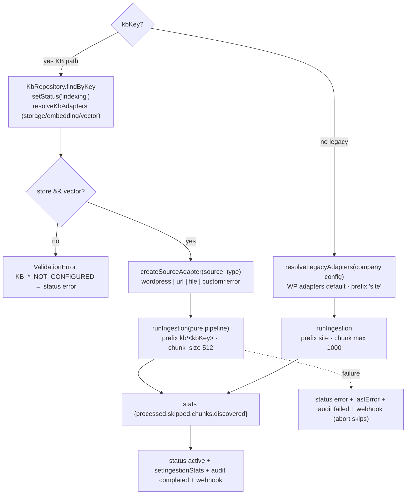

# Ingestion

## Purpose

Fetch source documents → convert to Markdown → chunk → embed → store chunk JSON + vectors → remember progress. Runs as an abortable background job (manual or scheduled), scoped per company and optionally per KB.

## Composition root — `ingest.js main({signal, companyName, kbKey, maxPages, scope})`

## Pure pipeline (`ingest/pipeline.js`) stages

1. `store.ensureBucket()` / `index.ensureIndex()` (abort-checked).
2. Per content type (`scope.contentTypes` default post+page):
   - **all / limit** modes paginate `fetchPost`/`fetchPage`; **selected** mode batches IDs via `fetchWpByIds`.
   - `registry.isStale(key, modifiedDate)` skips unchanged docs.
   - `transformItem`: clean → chunk ([[Document Processing & Chunking]]) → build vector chunks with deterministic ids & r2 keys ([[Vector Data & Chunk Files]]).
   - Upload chunk JSONs concurrently (p-limit 5) then `index.upsert(vectorChunks)` owns embedding+batching.
   - `registry.record(key, modified)` after each doc.
3. Stats accumulate; `setProgress` phases emitted (fetching→done).

## Source adapters

| Type | Module | Notes |
|---|---|---|
| wordpress (default) | services/wp.js via wpAdapters | X-WP-TotalPages pagination, 300 ms pacing |
| url | ingest/sources/url.js | direct list or sitemap.xml (+child sitemaps), cheerio extraction article→main→body, per-fetch timeout/retries/concurrency |
| file | ingest/sources/file.js | txt/md/html/pdf/docx from upload staging, copy into content/<company>/uploads |
| custom | throws | callers must inject own adapter through gateway ingest API |

All return WP-shape items so the pipeline stays provider-agnostic.

## Adapter resolution (`ingest/resolve.js`)

KB rows bind infrastructure ids: storage_resource_id → connection credentials → `{cloudflare-r2,s3}` store factory; embedding_model_id → provider/model resolution → first active credential of that provider (decrypted) → embedding factory (cloudflare-ai/openai/openrouter); vector_resource_id → vector factory receiving the embedding adapter. Cloudflare creds fall back to company config on the legacy path.

## Failure, abort & notifications

AbortError at any boundary unwinds cleanly (job entry removed, no status flip). Real failures flip KB status/error, persist stats=0 case, write audits, fire webhooks (HMAC-signed) — [[Logging & Audit]], [[Background Jobs]].

Registry rules incl. fingerprint invalidation: [[ADR - File-based ingestion registry]]. Tests: ingest/__tests__/{pipeline,kb-pipeline,scope,resolve,pipeline v5}.