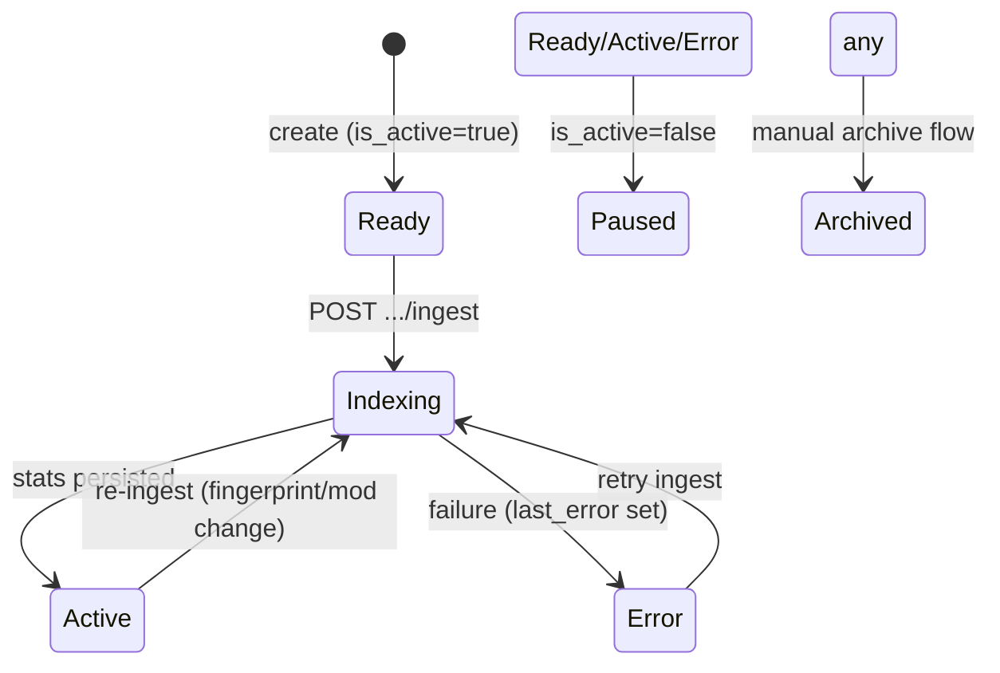

# Knowledge Bases

## Purpose

A **KB row** is the tenant-level unit that binds one embedding model + one object-storage resource + one vector-store resource (+ optional graph/webhook/source config). Ingestions are addressed to a KB; assistants point their retrieval at a KB's external index.

## Data model essentials (columns consumed by code)

`knowledge_bases`: kb_key (route identity, `/^[a-z0-9-]+$/`), company ownership, display name, is_active, status (active|indexing|error|archived tone-mapped by shared/status.js), source_type + source_config JSON ([[Ingestion]]), chunk_size (default 512), retrieval_top_k, embedding_model_id + model snapshot, vector_/storage_/graph resource ids + vector_external_id + storage_external_id, webhook_url + webhook_secret, last_error, ingestion stats block (duration/documents/chunks/mode).

Service layer enforces duplicate-key 409, capacity gates, resource-ownership checks (resource must belong to same company), and audit writes — pattern sibling to assistant-service.

## Lifecycle state machine

The portal derives ONE badge via `shared/status.js kbLifecycle(kb,status)` priority: Indexing > Error > Paused > Active > Ready — so DB fields never render conflicting states.

## Endpoints group (router `mysql/routes/kbs.js`, mounted `/gateway`, requireGatewayCompany)

- `GET /kbs/options` — one round-trip create-modal payload: registry rows for vector/storage/graph resources + embedding models **plus live account resources** for the selectors.
- CRUD: list (paginated+redacted), create, get, update (kb_key immutable), delete.
- Operations per key: sources listing, documents listing/removal, **ingest** start, status, source-pages (WordPress picker catalog), ingest-progress live polling.

Documents ingest/cancel ultimately drive the shared standalone-job runner ([[Background Jobs]]) with dedupe against already-running company+KB pairs (409).

## Retrieval coupling — decided via ADR-012 (2026-08-27)

The historical caveat ("KB-backed indexes provisioned to other providers receive data but aren't readable by the ask path") is superseded by **[adr-012-multi-provider-ask-retrieval](../../../docs/adr/adr-012-multi-provider-ask-retrieval.md)**: phased multi-provider ask-retrieval is accepted scope — CF fast-path preserved, KB-driven resolver added, vendor-payload content doctrine adopted as end-state (CF's R2 mirror transitions later), Pinecone → Qdrant → Weaviate rollout behind fat dual-mode adapters, graceful degradation for unresolvable bindings, and a binding-fingerprint fix for the answer-cache key riding in Phase 1. Until those phases land, the statements below remain true and are preserved for archaeology:

> Asking uses `VECTOR_INDEX`/assistant override through the **Workers-AI-only** query seam; KB-backed indexes provisioned to other providers receive data but aren't read by the ask path today. Assistant primary-KB binding passes only the external index name.

## Webhooks

Optional per-KB notification URL/secret fires post-ingest success/failure with platform-adaptive payloads ([[Ingestion]]; formatting bug note TD-2).

Related pages: [[Data Lifecycle]], [[ADR - Provider-agnostic adapter layer]]. UI: Ingestion.jsx hub.