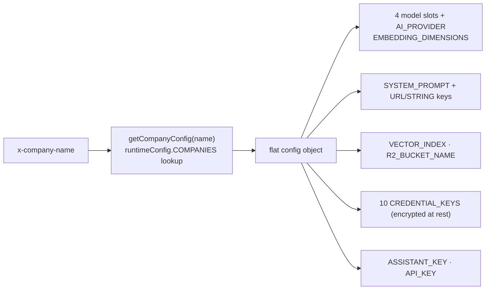

# Multi-Tenancy & Company Config

## Purpose

Give every customer (company) an isolated brain: its own models, persona/system prompt, website URLs, vector index, R2 bucket, credentials, optional graph connection, selected assistant, and optional ask API key — switched per request by `x-company-name`.

## Model

Allowed keys are whitelisted in `config/schema.js` (`COMPANY_KEYS` grouped into MODEL/DIMENSION/URL/STRING/PROMPT/RESOURCE/ASSISTANT/CREDENTIAL/SECRET/PROVIDER lists + `CONFIG_SECTIONS` driving portal cards). Defaults come solely from `DEFAULT_COMPANY` — nothing is seeded from environment variables.

## Write path guarantees (`config/company.js`, `config/write.js`)

- **persist-first**: `createCompany/updateCompany/setCompanyApiKey` await the backend write before touching `runtimeConfig`; failures return `{error}` leaving memory untouched (deletes restore the original entry).
- Changing `EMBEDDING_MODEL` auto-updates `EMBEDDING_DIMENSIONS` from the `EMBEDDING_DIMENSIONS` map (`applyModelDimensions`) — enforced on both API routes and internal writes.
- Validation lives in `config/validation.js`: company/resource names `/^[a-z0-9-]{3,63}$/`; keys must be whitelisted.
- Resets: `resetPrompt` (prompt only), `resetCompanyConfig` (defaults for tenant), `resetConfig` (dangerous: wipes all company DBs). ⚠️ reset helpers mutate memory *before* awaiting save ([[Technical Debt]] TD-4).
- Deletion removes both backends' records (`deleteCompanyDb`); MySQL side soft-deletes the tenant row. **No automatic Vectorize/R2 teardown** was found in the reviewed path — cloud resources linger unless manually removed (stated as observation; treat orphan cleanup as operator duty).

## Boot lifecycle

SQLite backend loads synchronously at import; MySQL backend fills the singleton during `initConfig()` awaited by app.js/cli before serving. First MySQL boot lifts existing SQLite companies **only when the MySQL companies table is empty** (plus legacy runtime-config.json JSON lift, a mechanism retained in store.js even though no such file ships today). See [[Configuration]].

## Derived tenant identity quirks

A company name doubles as its website identity: CORS allow-rules and ask-origin checks derive `<company>.com` (+ subdomains) from the literal name (`utils/request-context.js`). Choosing `acme` makes `https://support.acme.com` a valid origin for its widget traffic.

## Implementation index

`config/{schema,index,store,sqlite,mysql-store,codec,encryption,creds,company,write,validation,prompts}.js` · routes `routes/cloudflare/{companies,config,prompt,apikey}.js` · portal Companies.jsx/Config.jsx · tests `config/__tests__/*`.

Related: [[Ask API Keys]], [[Assistant Personas]], [[Data Stores]], [[ADR - Per-company multi-tenant isolation]], [[ADR - Dual config store with CONFIG_STORE switch]].