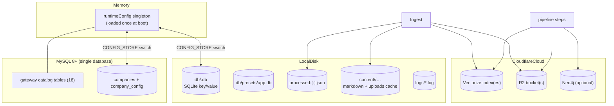

# Data Stores

Four persistence systems coexist (deliberate, verified):

## Store responsibilities

| Store | Holds | Owner module |
|---|---|---|
| runtimeConfig memory | merged per-company config dicts | config/store.js |
| SQLite per company (`config` table) | same keys, JSON-encoded, sensitive gcm-encrypted | config/sqlite.js |
| MySQL `companies`+`company_config` | identical format backend (002 migration) | config/mysql-store.js |
| Gateway tables | providers/auth schemas/models/pricing/endpoints/capabilities/resource types/resources/credentials(+access)/companies/environments/KBs/assistants/chatbots/agent_workflows/usage logs/audit_logs + views | mysql/repositories/* |
| presets SQLite | scheduler preset rows only (subdir keeps company discovery safe) | config/presets.js |
| Registry JSONs | last-modified keys + `__meta` fingerprint per company/kb | ingest/registry.js |
| content/ | cleaned markdown written during ingestion + uploaded-file staging | pipeline/store adapters |
| logs/ | operational + request logs | utils/logger.js |
| Vectorize | embeddings + indexed metadata | services/vectorize.js |
| R2 | chunk JSON documents | services/r2.js |

## Consistency rules between them

- Config sources of truth: **memory is read-path authority** within a process; DB is durability truth. Persist-first writes close the gap except the two reset helpers flagged in TD-4.
- Gateway credential blobs ↔ RAG config credentials are linked by **mirror sync**, not FKs — deletions recompute liveness across remaining connections ([[ADR - Gateway-to-RAG credential mirroring]]).
- Chunk JSON on R2 is authoritative text for answers; Vectorize metadata only points at r2_key.

Deep dives: [[Config Store Schema]] · [[MySQL Gateway Schema]] · [[Vector Data & Chunk Files]].