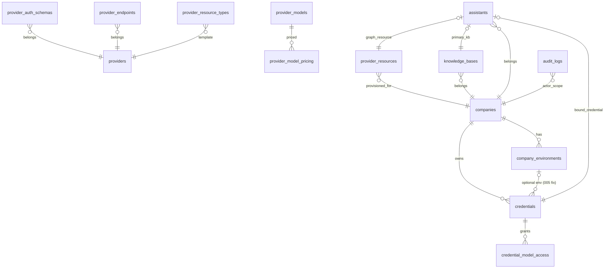

# MySQL Gateway Schema

Canonical file: `schema/v5.sql` (frozen reference). Applied incrementally by `migrations/`.

## Tables (18, from v5)

`companies`, `company_environments`, `providers`, `provider_auth_schemas`, `provider_endpoints`, `provider_models`, `provider_model_pricing`, `provider_capabilities`, `provider_resource_types`, `credentials`, `credential_model_access`, `provider_resources`, `knowledge_bases`, `assistants`, `chatbots`, `agent_workflows`, `credential_usage_logs`, `audit_logs`

## Views (8)

`v_credentials_full` (LEFT JOIN semantics fixed by migration 005), `v_provider_capabilities`, `v_provider_auth_form`, `v_provider_resource_templates`, `v_model_pricing_current`, `v_credential_models`, `v_company_resources`, `v_company_usage_summary`.

## Relationship map (confirmed by repositories/migrations usage)

Soft deletes via `deleted_at` on tenant-scoped entities; ENUM vocabularies mirrored by `shared/catalog-enums.js`; `credential_usage_logs` uses partitioning + FKs (**MySQL-only** requirement; MariaDB shim strips PARTITION in runner).

## Migration files

Twenty-two incremental SQL files (truth: `ls migrations/`). Early evolution documented individually below; later catalog/platform waves are self-describing by filename and header comment — always consult file headers before writing migrations.

| File | Adds |
|---|---|
| 001_init | full DDL verbatim from v5 (no seed) |
| 002_company_config | company_config KV table for [[Config Store Schema]] |
| 003_platform_seed | endpoints+pricing DML |
| 004_seed_catalog | global providers/auth/forms/capabilities/resource-types/models seed |
| 005_credentials_view_left_join | view shows unassigned credentials |
| 006_seed_catalog_children | backfills child rows for blank providers created post-004 |
| 007_seed_existing_provider_auth | provider-specific auth-schema fields so credential forms collect real fields (e.g. CF Account ID), not one generic key |
| 008_reseed_catalog | idempotent catalog reseed aligned with live DB reality |
| 009_seed_ai_provider_catalog | completes 9Router-style AI provider set (base URL + auth header + key schema + default models) |
| 010_seed_9router_catalog | further provider additions (venice, vercel-gateway, jina, voyage, selfhosted-embedding…) |
| 011–017 | provider round-robin/thinking config · provider doc URLs · assistant_variables · ingestion stats persistence · KB source_type · KB source_config · KB webhooks |

**Wiki-sync note (2026-08-27):** migrations 007–017 landed after this vault's initial authoring pass; several capabilities previously flagged as absent (assistant variables, persisted ingestion stats, KB webhooks/source-config) now exist at the schema layer — feature pages were updated only where their claims conflicted ([[Knowledge Bases]]); a full feature-layer audit against 011–017 remains an open wiki task ([[Technical Debt]] TD-5 umbrella).

## Runner semantics to respect

Filename-order, SHA-256 checksummed (edits after apply fail loudly), DELIMITER-aware parser, dedicated non-pool connection, auto-applied at boot when CONFIG_STORE=mysql, statement-level error pinpointing, `MIGRATIONS_DIR` override. Add **new** files only ([[ADR - Frozen v5 schema and checksummed migrations]]).