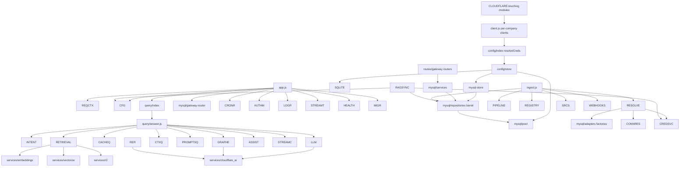

# Dependency Map

## Module layering (imports verified)

## Deliberate acyclicity islands (must preserve)

| Rule | Reason recorded |
|---|---|
| `config/store.js` never imports `config/index.js` or higher | prevents import-cycle TDZ (file header history) |
| `query/assistant.js`, `query/graph.js` lazy `await import()` repos/driver | zero-dep loadability of query tests |
| Routes compose via barrels (`mysql/routes/index.js`, `repositories.js`, `cloudflare.js`) | import sites frozen during clean-architecture splits |

Strongest fan-out hubs: `web/src/api.js` (degree ~80 per PROJECT_CONTEXT metrics), `mysql/pool getPool()` (~19), schema SQL nodes.

## Shared code duplicated-on-purpose-free zones

`shared/*` consumed by BOTH server and portal (#shared alias) — changes must keep node --test compat (no deps rule) enforced by existing tests importing them directly.

## Package↔feature map highlights

express→everything HTTP · mysql2→pool/migrations/stores · cloudflare SDK→client seam consumers · aws-sdk-s3→r2 services+storage adapter · node-cron→lifecycle · pdf-parse+mammoth+cheerio+turndown→sources/cleaner · p-limit→concurrency · neo4j-driver→lazy graph · swagger-ui-*→docs mount.

## Findings register (details → [[Technical Debt]])

- **Unexpected/dead deps:** `axios` declared but no runtime import located (verify then drop); `wrangler` carries platform tooling weight though app never calls it.
- **Critical single points:** `node:sqlite` builtin pins Node floor; `undici override` pins audit-clean state.
- **No circular domain loops detected** in this pass; guard rules above exist because two were fixed historically (comments cite TDZ incident).
